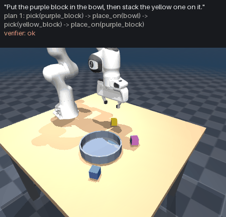
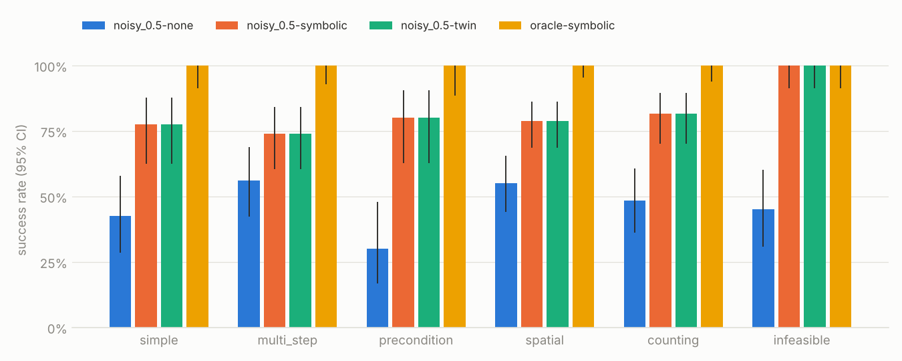

# Language to Robot Actions, Verified

**An LLM turns plain instructions into robot action plans. A checker tests every
plan before it runs and checks every step after it runs, and an evaluation
harness measures what each piece is worth with paired statistics.**



```text
"Put the red block in the bowl, then stack the green one on it."
 plan 1: pick(red_cube) -> place_on(bowl) -> pick(green_block) -> place_on(red_block)
 verifier: Step 1 pick(red_cube): there is no object 'red_cube'. Objects present: ...
 plan 2: pick(red_block) -> place_on(bowl) -> pick(green_block) -> place_on(red_block)
 verifier: ok  ->  executed in MuJoCo, every step checked  ->  success
```

The repair loop above is [`docs/media/demo_repair.gif`](docs/media/demo_repair.gif).
Its first plan comes from the synthetic test planner, not an LLM (see below).

## Status: what is measured and what is not yet

| | Status |
|---|---|
| Simulator, skills, verifier, executor, task suite, harness, statistics | Built and tested (`pytest`: 100 tests) |
| **Execution ceiling**: a correct plan succeeds in simulation | **300 / 300** episodes, 95% CI [98.7%, 100%] ([report](results/report.md)) |
| Pipeline check with a synthetic planner (verifier off / symbolic / twin) | Done: see [Pipeline check](#pipeline-check-synthetic-planner) |
| **LLM results** (verifier effect, model and prompt comparisons, which instructions break LLMs) | **Not run yet.** These need an API key. The commands are in [Running the experiments](#running-the-experiments) |

No number in this README comes from a language model, because none has been run
yet. When one has, its results go in `results/`, produced by `lang2act report`.

## What it does

```
instruction + scene ──> LLM planner ──> plan (strict JSON) ──> verifier ──┐
                             ^                                            │ rejected:
                             └──────── findings, in plain English ────────┘ fix it
                                                                          │ accepted
                                                                          v
                         goal check <── MuJoCo executor, each step's effect checked
```

**Planner** (`planners/`). The instruction and a scene description (object ids,
colours, positions measured in the simulator) go in. A plan in a fixed format
comes out: `pick(object)`, `place_on(object or bowl)`, `place_at(x, y)`.
Implemented for Claude (Anthropic SDK) and for any OpenAI-compatible server,
which includes local models through Ollama. Two prompt versions: `basic` and
`fewshot`.

**Verifier** (`verifier.py`). Before anything moves, it steps the plan through a
model of the table and rejects impossible steps. It catches an object that isn't
there, picking something with a block on top, picking with a full hand or
placing with an empty one, placing onto an occupied block, stacks that are too
tall, a full bowl, points off the table or against the bowl, and **grasps and
placements the arm cannot reach**. Reach is checked by solving the Panda's
inverse kinematics, not by a distance rule. Each finding is written for the LLM
to read; the planner gets up to two rounds to fix the plan. A second mode,
`twin`, then dry-runs the plan in the simulator from a snapshot and restores it.

The verifier never sees the instruction or the goal. It answers "can this plan
run?", never "does it do what was asked?". Giving it the goal would turn it into
an oracle, and the improvement it bought would only measure that leak.

**Executor** (`executor.py`). Runs the plan in MuJoCo with a Franka Panda. After
every step it checks that step's postcondition: after `pick(x)` the gripper holds
`x`; after `place_on(y)` the block rests on `y`. The first failure stops the
episode and is recorded against that step.

**Evaluation harness** (`harness.py`, `compare.py`, `report.py`). A fixed suite
of 30 instruction templates × 10 seeded scenes. Every planner, prompt and
verifier setting sees the same 300 episodes, so any two runs are matched pairs.
Every run reports success rates with confidence intervals, and every comparison
returns a verdict: **better**, **worse**, **equivalent** or **underpowered**.

## The task suite

Six categories, chosen to answer *which kinds of instruction break LLM planners*.
`lang2act tasks` prints a sample instruction from every template.

| Category | Templates | Example |
|---|---:|---|
| `simple` | 4 | "Drop the green cube into the bowl." |
| `multi_step` | 5 | "Build a tower with the yellow block at the bottom, the orange block in the middle and the green block on top." |
| `precondition` | 3 | "Put the orange block in the bowl." (something is sitting on it) |
| `spatial` | 8 | "Put the blue block in front of the red block." / "Put the leftmost block in the bowl." |
| `counting` | 6 | "Put two of the yellow blocks in the bowl." / "Put every block except the purple one in the bowl." |
| `infeasible` | 4 | "Put the red block in the bowl." (there is no red block, or it is out of reach) |

On an infeasible task, success means the robot leaves the table alone. Either
the planner says the task is impossible or the verifier stops it. Scenes are
generated from `(template, seed)`, and each template's reference plan defines
the execution ceiling.

Spatial words have exact definitions, and **the planner is told them**, with
the same numbers the grader uses: "left of" means 8–20 cm further toward +y,
within 6 cm in x. A test checks that the prompt and the grader cannot drift
apart.

## Pipeline check (synthetic planner)

`noisy:0.5` is not a language model. It takes the reference plan and, half the
time, injects a typical LLM mistake: a hallucinated id, a missing pick, the
wrong object, an unreachable point, a false "impossible", or acting on an
impossible instruction. When the verifier objects, it fixes the plan 70% of the
time. It reads the ground truth, so **its numbers only show that the
machinery works**: the verifier catches what it should, the repair loop runs,
and the statistics resolve a large effect. They say nothing about LLMs.

All four runs are in [`results/report.md`](results/report.md) and their
per-episode records in `runs/core_v1/`.

| Synthetic planner `noisy:0.5` | Success (95% CI) | vs. verifier off |
|---|---|---|
| Verifier off | 48% [43%, 54%] | |
| Verifier `symbolic`, 2 repair rounds | 81% [77%, 85%] | **+33.0 points** [+26, +40], 99 wins / 0 losses, `BETTER` |
| Verifier `twin` | 81% [77%, 85%] | identical to `symbolic` |
| Oracle (execution ceiling) | 100% [99%, 100%] | |

What this confirms about the machinery, and nothing more:

- The verifier rejected 108 of 300 first drafts, mostly unknown ids (40), points
  off the table (32) and placing with an empty hand (23). Of those, 97 were
  repaired. With the verifier off, the same mistakes surfaced during execution:
  62 episodes stopped at a step that could not be attempted, 39 at a step that
  failed physically, and on 7 impossible tasks the robot moved blocks anyway.
- 20 episodes end `goal_not_met` under every setting. Those are wrong-object
  plans: valid and executable, but not what was asked. The verifier passes them
  by design, because it does not know the goal.
- `twin` adds nothing here because every injected mistake breaks a symbolic
  rule. With an LLM, the cases worth checking are plans that pass the symbolic
  rules and still fail physically.
- 0 losses is an artefact of the setup. Both arms get an identical first draft,
  so feedback can only help. With an LLM the verifier can also cost episodes,
  by rejecting a plan that would have worked and then failing the repair. That
  is part of what the real experiment measures.



## Running the experiments

```bash
git clone https://github.com/abyyworld/language-to-robot-actions
cd language-to-robot-actions
pip install -e ".[anthropic,viz,dev]"     # Python >= 3.10
lang2act assets                           # pinned Franka Panda meshes, ~33 MB
pytest                                    # ~15 s
```

The finding the project is built for is **how much the verifier improves
success**. Run it with one model:

```bash
export ANTHROPIC_API_KEY=...
make exp-verifier MODEL=anthropic:claude-haiku-5-5    # verifier none / symbolic / twin
make exp-models   MODEL=anthropic:claude-haiku-5-5 MODEL_B=anthropic:claude-sonnet-5-5
make exp-prompts  MODEL=anthropic:claude-sonnet-5-5   # basic vs fewshot
make report                                           # results/report.md + chart
```

A free alternative is a local model: `ollama pull qwen2.5:7b`, then
`MODEL=ollama:qwen2.5:7b`. Local runs are seeded end to end (temperature 0,
fixed seed).

Single commands:

```bash
lang2act run --planner anthropic:claude-haiku-5-5 --verifier symbolic --workers 8
lang2act compare runs/core_v1/A runs/core_v1/B          # paired verdict, per category
lang2act show runs/core_v1/A --template between --seed 3 # one episode's full trace
lang2act demo --template tower_four --planner anthropic:claude-sonnet-5-5 --out tower.gif
```

**Cost, roughly.** A planning call is about 800 input tokens; output is the JSON
plus the model's thinking, which dominates. Assuming ~1.3 calls and ~1,500
output tokens per episode, a 300-episode run costs about **$0.35 on Claude Haiku
5.5, $7 on Sonnet 5.5 and $14 on Opus 5.5**. Treat these as estimates; the
report prints the actual token totals of every run. Responses are cached on
disk, so reruns and resumed runs cost nothing.

**A useful side effect of the cache.** The request for a first draft is the
same whatever the verifier setting, so `none`, `symbolic` and `twin` runs share
the **same first draft** for every episode. Only the repair rounds differ. The
verifier comparison then measures what feedback adds, with no sampling noise
from the first draft.

## How comparisons are decided

From [`vla-evals`](https://github.com/abyyworld/vla-evals), extended here:

- **Paired by episode.** Both runs face identical `(template, seed)` episodes.
  Runs on different suites are refused.
- **McNemar's exact test** on the discordant pairs, plus a **bootstrap interval
  that resamples whole templates**: ten seeds of one template share their
  wording and difficulty, so they are not ten independent observations.
- **Verdict.** `BETTER` / `WORSE` needs the exact test (p < 0.05) *and* the
  interval to exclude zero. `EQUIVALENT` means the whole interval is within ±5
  points. Anything else is `UNDERPOWERED`, reported with roughly how many
  paired episodes would resolve it.
- **Per-category verdicts use Holm-corrected p-values**: testing six categories
  at once otherwise yields a spurious "significant" category about a quarter of
  the time.
- **API errors are dropped from both sides of the pair** and counted. An outage
  is not evidence about a planner. Refusals are kept and counted as failures.

300 paired episodes can resolve roughly an 8-point difference overall, when the two
runs disagree on about 20% of episodes. A single
category (30–80 episodes) can resolve only large ones. Smaller effects come back
`UNDERPOWERED`, and that verdict is the honest answer.

## Decisions that affect what the numbers mean

- **No refusal fallbacks.** The Anthropic API can re-run a refused request on a
  different model. That would put one model's name on another's plan, so here
  a refusal is recorded as a refusal. The served model is read from each
  response and stored.
- **Effort is fixed explicitly** (`medium` unless `--effort` says otherwise),
  because Claude models default to different levels and comparing them at
  different effort would confound the comparison.
- **Structured outputs on by default.** `--no-structured` turns format
  following back into part of what is measured.
- **The motion layer uses ground-truth poses.** The experiment is about the
  plan, so motion must be close to perfect. The 300/300 ceiling shows it is.
  Perception is out of scope.
- **The `twin` verifier is an upper bound.** Its "digital twin" *is* the
  simulator the plan then runs in, which no real robot gets. It measures the
  most a perfect simulation check could add, not a deployable system.

## Reused code

Built on two earlier projects instead of rebuilding them (details and commit
hashes in [VENDORED.md](VENDORED.md)):

- [`vla-evals`](https://github.com/abyyworld/vla-evals): paired statistics
  (bootstrap, exact McNemar, sample size), the seeded fixed-suite design, and
  the "refuse to call an underpowered comparison" verdict logic.
- [`Interactive-correction-for-manipulation`](https://github.com/abyyworld/Interactive-correction-for-manipulation):
  the MuJoCo Franka Panda scene, damped-least-squares IK, Cartesian control,
  grasp detection, exact snapshot/restore, and the scripted pick-and-place
  expert that became the `pick` / `place` skills.

## Layout

```
src/lang2act/
  sim/            MuJoCo world, scene builder, IK, Panda wrapper, pick/place skills
  scenes.py       seeded scene generation; the scene description the planner sees
  tasks.py        30 templates in 6 categories: scene, instruction, goal, reference plan
  predicates.py   what "on", "in the bowl", "left of" mean (shared by goals, checks, prompt)
  plan.py         plan schema and parser
  verifier.py     pre-execution checks (symbolic, twin)
  executor.py     runs a plan with per-step postconditions
  planners/       Claude, OpenAI-compatible/Ollama, oracle, synthetic; prompts
  episode.py      plan -> verify -> repair -> execute -> goal check, one record per episode
  harness.py      suites, resumable runs
  stats.py        statistics (from vla-evals, extended)
  compare.py      paired verdicts
  report.py       markdown report and chart
suites/           versioned suite definitions (never edited in place)
results/          reports generated from runs
runs/             per-episode records of every run in results/
```

## Limitations

- Simulation only. The scene description comes from simulator state, not perception.
- Three action types. Instructions that need pushing, pouring or tool use are out of scope.
- Spatial relations are graded on fixed thresholds. They are stated to the planner, but they are still one definition of "left of".
- The verifier can only reject plans that break its rules. A valid plan that does the wrong thing (the wrong block in the bowl) passes, by design, and shows up as `goal_not_met`.
- Claude's current models take no temperature or seed. Their runs are reproducible through the response cache, not through seeding.

## License

MIT. The Franka Panda model is fetched from MuJoCo Menagerie (Apache-2.0).
